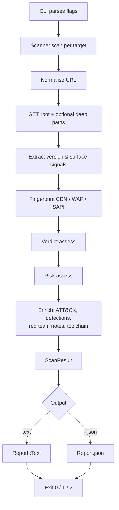

# PHP2ShellPOC2026

A passive exposure analyzer for the PHP2Shell bug class (CVE-2026-109618 and
CVE-2026-109619). Point it at a URL and it tells you, in one screen: which PHP
interpreter is running behind that endpoint, whether that interpreter is past
the fix level for its branch, how the deployment (SAPI, CDN, WAF) changes what
an attacker could realistically do with it, which MITRE ATT&CK techniques the
finding maps to, and what a blue team should be detecting right now.

It never sends anything more aggressive than an ordinary GET request. There is
no exploit code, no payload, no fuzzing, and no state-changing verb anywhere in
the codebase — by design, not by configuration.

---

## Table of contents

- [The problem it solves](#the-problem-it-solves)
- [Who runs this](#who-runs-this)
- [How it works, stage by stage](#how-it-works-stage-by-stage)
- [The four verdicts](#the-four-verdicts)
- [How the risk score is built](#how-the-risk-score-is-built)
- [Is it hackable? Evidence weighting](#is-it-hackable-evidence-weighting)
- [The attack surface flags](#the-attack-surface-flags)
- [ATT&CK mapping](#attck-mapping)
- [Detection opportunities for the blue team](#detection-opportunities-for-the-blue-team)
- [The red team perspective and toolchain](#the-red-team-perspective-and-toolchain)
- [Installing and running](#installing-and-running)
- [Command-line flags](#command-line-flags)
- [Exit codes](#exit-codes)
- [Output formats](#output-formats)
- [Safety properties](#safety-properties)
- [Project structure](#project-structure)
- [Diagrams](#diagrams)
- [Extending the tool](#extending-the-tool)
- [Contributing](#contributing)
- [License and disclaimer](#license-and-disclaimer)

---

## The problem it solves

PHP2Shell is a pair of flaws in PHP's own request handling — CVE-2026-109618
and CVE-2026-109619. Both fire while the request is being parsed, which is
before a single line of your application code runs. That has two consequences
people consistently underestimate:

**Application-layer defence does not apply.** Authentication, SSO, IAM,
authorisation middleware — none of it has executed yet when the parser hits
the malformed input. An endpoint that requires no login is not "less exposed"
here; every `.php` route on the host is an equally valid entry point.

**The blast radius is the interpreter, not the app.** The two variants of the
bug resolve either to code execution as the web worker (`www-data`, `apache`,
`nginx`) or to a Heartbleed-style memory disclosure that leaks environment
variables, cloud credentials and session material without achieving execution
at all. A "successful" attack does not have to crash anything, which means
availability monitoring will not reliably catch the probing phase.

Compounding this: the fix landed per branch at 8.2.35, 8.3.36, 8.4.27 and
8.5.12. Anything below branch 8.2 — all of 5.x, 7.x, and 8.1 — is end-of-life
and never received a fix at all. Those hosts can only be cleared by a
distro backport someone has actually confirmed is applied, or by an upgrade.

Nobody advertises `X-Powered-By: PHP/8.1.2` and thinks about what that string
means to an attacker. This tool reads the same signals an attacker would, then
turns them into a verdict, a score, a kill chain, a set of detections — and,
at the bottom of the report, an evidence-weighted **hackable / not-hackable**
rating with the positivity ratio behind it.

## Who runs this

**Blue team / defenders** use it to find out which hosts in the estate are
actually running a vulnerable interpreter, and to pull the detection
opportunities that apply to the specific deployment found — the report names
concrete WAF rules, log greps and EDR alerts, not generic advice.

**Purple team** uses the ATT&CK mapping and detection layers together: the
attack chain says what an adversary would do, the detections say where to
observe it, and the two are keyed to the same finding so they line up.

**Red team / authorized testers** use it as a scoping step. Before deciding
which of the standard tools in the catalogue are worth running against a host,
you want to know whether the interpreter is even vulnerable, whether the
session-upload path is reachable, and whether a WAF is sitting in front —
all of which this establishes passively.

**Engineering / DevSecOps** run it in CI or on a schedule against production
endpoints as a regression check: an interpreter downgrade or a forgotten
staging box shows up as a non-zero exit code.

## How it works, stage by stage

The scanner runs one pass per target, in this order:

**1. Normalisation.** The target string becomes a URI. A bare hostname gets
`https://` assumed; anything that is not an HTTP(S) URL after parsing is
rejected. Empty paths become `/`.

**2. Passive probing.** One GET request to the root, with an honest
`User-Agent` identifying the tool, a configurable timeout (10 seconds by
default), full TLS verification (unless you pass `--insecure`), and redirects
followed up to five hops. With `--deep` it also probes `/index.php` and the
usual phpinfo locations (`/phpinfo.php`, `/info.php`, `/test.php`, `/i.php`,
`/php.php`) — worthwhile when the root gives you nothing to work with.

If a request fails — refused, timed out, bad certificate — that probe is
recorded as unusable and the scan continues. A dead path degrades the verdict
towards `unknown`; it never aborts a run against a host you can otherwise
reach.

**3. Evidence extraction.** Each usable response is kept whole (headers,
status, body) and interrogated for four signals: the PHP version advertised in
`X-Powered-By`, an exposed phpinfo page that states the version outright, a
`PHPSESSID` cookie proving the session-upload-progress machinery is live, and
PHP's own error-page wording. The version is taken from the first signal that
produces an exact number — `X-Powered-By` first because it is precise,
phpinfo second because it is authoritative but rarer. Nothing is guessed from
response timings or page styling; the false-positive rate is not worth it.

**4. Deployment fingerprinting.** From response headers alone, the tool
identifies the CDN (CloudFront, Cloudflare, Fastly, Akamai), the WAF
(Cloudflare, Sucuri, Imperva/Incapsula), and — most importantly — the likely
SAPI. The SAPI decides exploit reliability: mod_php gives one request one
process with no recycle between victims, so exploitation is close to
one-shot; PHP-FPM makes an attacker land both requests on the same worker,
which is materially harder. nginx or an `X-Fastcgi-Cache` header reads as
FPM-likely; Apache with no CDN in front reads as mod_php-likely, the
highest-risk posture per the PHP project. Every SAPI call comes with a
written rationale so a human reading the report can judge the inference.

**5. Classification.** The extracted version is compared against the fix
level for its branch (see [The four verdicts](#the-four-verdicts) below).
Branches with no published fix are EOL before any comparison happens —
telling someone on 7.4 to upgrade to 8.2.35 is technically true and
practically useless.

**6. Risk weighting.** The verdict produces a base score, which the
deployment then adjusts — SAPI up or down, a CDN taking a point off. Full
method below.

**7. Evidence weighing.** Every observed fact — the fingerprint source, the
session cookie, the absence of a WAF, the SAPI posture — becomes a signed
signal that either supports or undermines exploiting this specific host. The
signals are totalled into a positivity ratio and a hackable / not-hackable
rating, which anchor the technical summary at the bottom of the report. Full
method below.

**8. Enrichment.** The finding is passed to four independent modules: the
ATT&CK mapper (kill chain), the detection builder (blue-team layers), the
red-team notes (attacker's-eye paragraphs for this host), and the toolchain
catalogue (the standard kit list, phase by phase, with an extra
origin-discovery entry added automatically when a CDN is detected).

**9. Rendering.** The run opens with the summary table, then text to the
terminal — optionally including the red-team notes, the toolchain and a
request-by-request trace with `--verbose` — or complete JSON with `--json`.
Every text block closes with the technical summary and remediation steps,
and the run closes with the cross-target run summary and a usage tip, then
the exit code. All text sizing to the terminal; see Output formats.

## The four verdicts

| Verdict | Meaning | Counts as exposed? |
|---|---|---|
| `patched` | Version is at or above the fix floor for its branch (8.2.35 / 8.3.36 / 8.4.27 / 8.5.12). | No |
| `vulnerable` | Version is below its branch's fix floor. The report says which floor it missed. | Yes |
| `eol` | Version is on a branch that never received a fix (5.x, 7.x, 8.1). Only backports or an upgrade clear it. | Yes |
| `unknown` | No version fingerprint exposed. The report tells you to try `--deep` or read the version off the host directly. | No |

`eol` counting as exposed is deliberate: "no fix exists" is a worse answer
than "below the fix level", not a better one.

Alongside the verdict, the report prints four attack-surface flags — see
[below](#the-attack-surface-flags) — which say how reachable the relevant
paths are, independently of which version is running.

## How the risk score is built

The score is CVSS-shaped but is not a CVSS vector, and it should not be
compared against a vendor's official score for this CVE. It starts from the
verdict and moves for what the deployment does with the bug:

- **Base:** `vulnerable` = 9.8, `eol` = 10.0, `unknown` = 4.0, `patched` = 0.0.
- **SAPI:** +0.2 for mod_php-likely (capped at 10.0) because exploitation is
  near one-shot reliable; −1.0 for FPM-likely on a vulnerable host because
  same-worker request pairing is a real friction the attacker must beat.
- **CDN:** −1.0 on any non-patched finding, on the reasoning that edge
  controls usually absorb naive probing. The origin-bypass caveat is printed
  alongside every time — the point is recoverable by finding the origin, and
  the report says so.
- The result is rounded to one decimal and clamped to 0.0–10.0, then graded:
  9.0+ CRITICAL, 7.0+ HIGH, 4.0+ MEDIUM, above zero LOW, zero NONE.

## Is it hackable? Evidence weighting

Every text run ends with a **technical summary** that answers the question a
report exists to answer — *can this host be hacked by this bug class, and how
confident are we* — and every multi-target run ends with a **run summary**
giving the positivity ratio across the whole batch.

The **positivity ratio** is `positive / (positive + negative)`, computed from
the signed weight of every observed signal. Signals are printed with their
weights so the arithmetic is auditable rather than mysterious:

- **Positive signals** push towards exploitability: an interpreter below its
  fix level (+4) or on an EOL branch (+5), the pre-authentication nature of
  the bug (+2), a live `PHPSESSID` proving the CVE-2026-109619 path is
  reachable (+2), no WAF observed (+2), a mod_php posture (+2), phpinfo
  exposure, verbose PHP errors, live `.php` entry points (+1 each), no CDN
  in front (+1).
- **Negative signals** push against it: the interpreter meets the fix
  level (−6), no PHP behaviour observed at all (−3), no version
  fingerprint — exposure unconfirmed (−3), a WAF in front (−2), a CDN
  masking the origin (−1), a FPM posture forcing same-worker request
  pairing (−1).

The ratio maps to a rating: **≥ 0.75 → HACKABLE**, **≥ 0.50 → LIKELY
HACKABLE**, **≥ 0.25 → INCONCLUSIVE**, below that **NOT HACKABLE**. Two
clamps keep the number honest: a host showing no PHP behaviour can never
rate above NOT HACKABLE, and an unconfirmed fingerprint can never rate above
LIKELY — an absence of evidence is not evidence of exposure, however many
peripheral signals accumulate.

The summary then states the **prerequisites** (what an attacker needs —
always unauthenticated TCP reachability for this class, plus the
upload-progress arm or same-worker pairing where relevant), the
**reliability** of exploitation for this deployment (mod_php is one-shot,
FPM needs retries, unknown SAPI means measure first), and the **impact**
if it is won — RCE as the web worker with webshell persistence, or silent
memory disclosure with no crash.

Risk and hackability deliberately answer different questions. Risk scores
how severe the exposure is (an EOL interpreter behind a CDN still scores
10.0); hackability scores how confidently the evidence supports exploiting
*this host, now*. A CRITICAL risk next to LIKELY HACKABLE is a coherent
result: severe if true, edge still hiding part of the picture.

## The attack surface flags

These four booleans are what the rest of the report hangs its claims on, and
each is a sentence someone can verify by hand against the host:

- **`php`** — PHP was positively detected on this endpoint at all (version
  header, session cookie, error page, phpinfo, or a `.php` path returning 2xx/3xx).
- **`upload_progress`** — a `PHPSESSID` cookie was issued, meaning the
  session upload-progress machinery behind CVE-2026-109619 is reachable here.
  This is the difference between "the interpreter is old" and "this specific
  path works".
- **`phpinfo`** — a phpinfo page is publicly readable. Attackers love these;
  the report flags it as surface, not just quietly using it for version
  extraction.
- **`php_errors`** — PHP's own error text leaked into a response body, which
  usually means verbose errors are on in production.

## ATT&CK mapping

When a host classifies as `vulnerable` or `eol`, the report prints a kill
chain built from techniques that genuinely apply to this bug class:

- **T1190 — Exploit Public-Facing Application (Initial Access):** one crafted
  request reaches the parser before any application code runs.
- **T1059.004 — Unix Shell (Execution):** confirmed exploit paths run
  commands as the web worker UID.
- **T1505.003 — Web Shell (Persistence):** a long-lived worker makes a
  webshell drop trivial, and successful execution need not restart the worker.
- **T1005 — Data from Local System (Collection):** the disclosure variant
  leaks process memory without achieving execution.
- **T1082 — System Information Discovery (Discovery):** recon through the
  hijacked interpreter looks like ordinary app traffic without EDR.
- **T1071.001 — Web Protocols (Command and Control):** C2 and exfil blend
  into normal HTTPS egress from the web tier.

On a patched or unknown host the chain is intentionally empty — there is no
confirmed exposure to map, and printing a kill chain anyway would train people
to ignore it.

## Detection opportunities for the blue team

The detection section is built per finding and ordered outermost-first, the
order traffic actually meets the controls:

1. **WAF** — rules for both arms of the bug: block
   `PHP_SESSION_UPLOAD_PROGRESS` in POST bodies (AWS WAF PHP Managed Rule
   Group v2.3+ covers this; ModSecurity inspects multipart bodies), and
   shrink the OOM surface with decoded body-size, part-count, field-count and
   nesting-depth limits.
2. **PHP logs** — grep FPM/Apache logs for memory exhaustion that happens
   *before* the script name appears; that ordering is the CVE-2026-109618
   signature.
3. **Web tier** — worker health anomalies: Apache child segfaults, FPM
   respawn storms. Exploitation can also succeed without any crash, so
   absence of segfaults is not a clean bill of health.
4. **EDR** — shells spawned by the web worker UID immediately after an
   inbound request, regardless of which CVE landed.
5. **Application** — responses with abnormally large or non-HTML bodies, or
   session cookies reflecting memory contents: the info-leak half.
6. **Network** (only when a CDN was detected) — audit origin reachability,
   because direct-to-origin traffic skips every edge rule.
7. **Config audit** (always) — verify the host-side hardening:
   `session.upload_progress.enabled=Off`, a non-overridable `memory_limit`,
   low `post_max_size`. Verify from a live web request, not the CLI, and
   restart every worker afterwards.

## The red team perspective and toolchain

`--redteam` prints short, opinionated paragraphs about this specific host —
which entry points are guaranteed to exist, why mod_php changes the odds, what
EOL means for how attackers will prioritise the target, and the operational
caveat that the disclosure variant probes silently.

`--toolchain` prints the standard toolchain for an engagement of this type,
grouped in the order an engagement actually runs — reconnaissance, scanning
and enumeration, vulnerability assessment, exploitation, post-exploitation,
command and control, persistence and collection, OPSEC and reporting. Every
entry carries a purpose and a relevance line explaining why it earned its
slot *for a PHP-facing estate*, plus the ATT&CK techniques it feeds; a host
sitting behind a CDN gets an extra origin-discovery entry because that is the
first thing worth doing to a fronted target. The catalogue covers the
expected standard kit — Amass, subfinder, Shodan/Censys, wafw00f, httpx,
Nmap, RustScan, ffuf, WPScan, Nuclei, SearchSploit, Metasploit, Burp, curl,
pwntools, LinPEAS, Impacket, NetExec, Cobalt Strike, Sliver/Mythic/Havoc,
chisel, and the rest — as scoping and training context printed next to a
passive finding. It contains no payloads and no exploit instructions.

## Installing and running

Requires Ruby 2.6 or newer. No runtime dependencies beyond the standard
library — nothing to bundle, nothing to audit.

```bash
# Run straight from the repository
./bin/php2shell-poc2026 https://www.example.com/

# Or install it as a gem
gem build php2shell_poc2026.gemspec
gem install ./php2shell_poc2026-2.2.0.gem
php2shell-poc2026 https://www.example.com/
```

A typical first pass against a host you have not seen before:

```bash
./bin/php2shell-poc2026 -d -r -c -v https://www.example.com/
```

`--deep` to widen the probe, `--redteam` for the attacker's view,
`--toolchain` for the kit list, `--verbose` to see every request the tool
made while it made up its mind.

## Command-line flags

| Flag | Effect |
|---|---|
| `-d`, `--deep` | Also probe `/index.php` and the common phpinfo paths, increasing the chance of pinning a version. |
| `-t`, `--timeout SECS` | Per-request timeout in seconds (default 10). |
| `-k`, `--insecure` | Skip TLS certificate verification — self-signed origins only. |
| `-r`, `--redteam` | Append the attacker-perspective notes for this host. |
| `-c`, `--toolchain` | Append the standard red-team toolchain catalogue. |
| `-v`, `--verbose` | Trace every request, response, redirect and failure the scan went through. |
| `-j`, `--json` | Emit the full JSON report. Always complete — flags never remove data from it. |
| `-V`, `--version` | Print the version and exit. |
| `-h`, `--help` | Print usage and exit. |

Multiple URLs may be given in one invocation; each is scanned and reported
independently.

The report sizes itself to the terminal: width comes from `COLUMNS` if set,
then the controlling terminal, then a conservative 80. Lines wrap with
hanging indents, long identifiers truncate rather than wrap, and the
summary table degrades to stacked rows on very narrow screens — a phone
terminal gets the same information in a different shape, with no horizontal
scrolling.

## Exit codes

| Code | Meaning |
|---|---|
| `0` | Every target classified `patched` or `unknown` — nothing confirmed exposed. |
| `1` | Usage error: no URLs given, unparseable flags, or every target failed to parse. |
| `2` | At least one target classified `vulnerable` or `eol`. CI-safe: fail the build on 2. |

A single malformed target in a list does not abort the run — it is skipped
with a warning and the remaining targets are still scanned and reported.

## Output formats

**Text** opens with a summary table — one row per target: verdict code,
risk, hackable yes/no and the positivity ratio — sized to the terminal
(and stacked into per-target rows when the terminal is too narrow for
columns). Then one block per target: verdict with severity and score,
version *and where that version came from* (X-Powered-By header or phpinfo
page), the reasoning that produced it, the four surface flags, the raw
observed evidence (header values, cookie names, status codes, probed
paths), the deployment fingerprint with its SAPI rationale, then the ATT&CK
chain, detections, and — only when you ask for them — red-team notes,
toolchain and trace. Each block closes with the evidence-weighted technical
summary (hackability rating, positivity ratio, every signal with its
weight, prerequisites, reliability, impact) and a remediation section —
concrete next steps with this host's version numbers, config keys and
honest fix-versus-compensation framing. The run then closes with the
cross-target run summary and a one-line usage tip.

**JSON** is machine-readable and holds the same eleven sections for every
target, regardless of which display flags were passed:

```
verdict · environment · risk · attack_chain · detections · red_team ·
tooling · fingerprint · hackability · remediation · trace
```

`verdict` carries `status`, `version`, `version_source`, `reason` and
`attack_surface`; `environment` carries `server`, `cdn`, `waf`, `sapi` and
`sapi_rationale`; `risk` carries `score`, `grade` and `scale`;
`fingerprint` carries the verbatim evidence (`x_powered_by`, `server`,
`cookie_names`, `statuses`, `probed_paths`); `hackability` carries the
`rating`, `label`, `ratio`, `positive` / `negative` weights, `hackable`
boolean, `prerequisites`, `reliability`, `impact` and the full signed
`signals` list; `remediation` is the ordered list of next steps printed in
the text report — ready to paste into a ticket; the three enrichment arrays
carry their full records (techniques with IDs and notes, detections with
layer and detail, tool entries with phase, purpose, relevance and
techniques); `trace` is populated when `--verbose` was used and empty
otherwise. The schema is treated as a stable contract — fields may be
added, not silently removed or renamed.

## Safety properties

These are guarantees of the implementation, not configuration options:

- Only `GET` requests are ever issued. No POST, no PUT, no verb that could
  change state on a live host.
- No payload, exploit or malformed request exists anywhere in the codebase;
  every request is one a normal browser could have sent.
- Redirects are followed to a bounded five hops, with a hard error beyond that.
- Every request carries a timeout, and failures degrade the verdict rather
  than crashing the run.
- TLS verification is on by default; `--insecure` is opt-in per invocation.
- The `User-Agent` honestly identifies the tool and links conceptually to
  this README — a defender seeing it in their logs should be able to find out
  exactly what it did.

## Project structure

One class or module per file, so a file can be read, reviewed and changed
without scrolling past three unrelated concerns:

```
PHP2ShellPOC2026/
├── README.md                     ← this file
├── LICENSE                       ← MIT
├── php2shell_poc2026.gemspec     ← gem packaging
├── bin/
│   └── php2shell-poc2026         ← executable entry point
├── docs/
│   └── UML.md                    ← class, sequence, pipeline and state diagrams
└── lib/
    ├── php2shell_poc2026.rb      ← single require that loads everything
    └── php2shell_poc2026/
        ├── version.rb            ← version and User-Agent identity
        ├── verdict.rb            ← the four verdicts and fix-level policy
        ├── probe.rb              ← one HTTP response + signal extraction
        ├── environment.rb        ← CDN / WAF / SAPI fingerprinting
        ├── attack.rb             ← MITRE ATT&CK kill chain
        ├── detections.rb         ← blue-team detection opportunities
        ├── red_team.rb           ← attacker-perspective notes
        ├── tooling.rb            ← standard red-team toolchain catalogue
        ├── risk.rb               ← exposure-weighted scoring
        ├── hackability.rb        ← evidence weighing, positivity ratio, hackable verdict
        ├── remediation.rb        ← what to do about the finding, per verdict
        ├── layout.rb             ← terminal width, wrapping, responsive summary table
        ├── scanner.rb            ← orchestration + ScanResult
        ├── report.rb             ← text and JSON rendering
        └── cli.rb                ← flags, exit codes
```

## Diagrams

Full UML — class diagram, scan sequence, pipeline flow and verdict state
machine — lives in [`docs/UML.md`](docs/UML.md). The short version of the
scan pipeline:



## Extending the tool

Each concern lives in exactly one file, so extension points are where you
would expect them:

- **A new ATT&CK technique** belongs in `attack.rb` as one `Technique` entry
  with its note explaining why it applies to this bug class.
- **A new detection** belongs in `detections.rb`; write the control and the
  concrete detail a detection engineer can act on without reading our source.
- **A new tool in the catalogue** belongs in `tooling.rb` — phase, purpose,
  relevance and the ATT&CK techniques it feeds. The relevance line is the
  part worth taking seriously: say why it earned its slot for a PHP-facing
  estate, not what the tool's homepage says.
- **A new fingerprint** (another CDN, another WAF, another SAPI tell) belongs
  in `environment.rb` or `probe.rb`, and should come with the same
  written rationale every existing one carries.
- **A new hackability signal** belongs in `hackability.rb` as one signed
  weight with a label an operator can act on — positive if it moves a host
  towards exploitability, negative if it holds it back. Weights are a
  judgement call, so say in the label why the number is what it is.
- **A new remediation step** belongs in `remediation.rb`, keyed to the
  verdict it follows from, written so it can be pasted into a ticket as-is:
  a version number, a config key, an action. If a reader cannot do the
  thing you described without asking a question, rewrite it.
- **A new output format** belongs in `report.rb`; scan logic should not need
  to change to add one.

A change is in good shape when `ruby -c` passes on every file and the
tool still returns 0, 1 and 2 correctly against a known-patched, a
known-unreachable and a known-vulnerable host.

## Contributing

Issues and pull requests are welcome. Keep the house style: one class or
module per file; comments explain *why* a decision was made, never restate
what the next line does; no doxygen parameter lists — the signature is
already there; and the passive-only property is non-negotiable. A PR that
adds an active probe, a payload or an exploit path will be declined
regardless of how useful it is, because that is the property that makes this
tool safe to point at production.

## License and disclaimer

MIT — see [LICENSE](LICENSE).

This tool performs passive reconnaissance only, but reconnaissance is still
reconnaissance. Scan only hosts and networks you own or have explicit written
authorization to assess. The authors assume no responsibility for use of this
tool outside lawful, authorized security testing.
