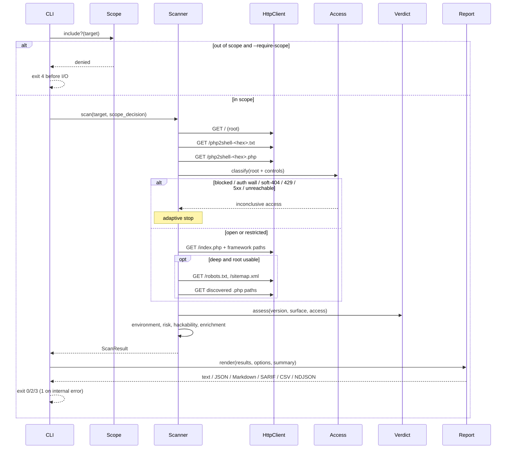
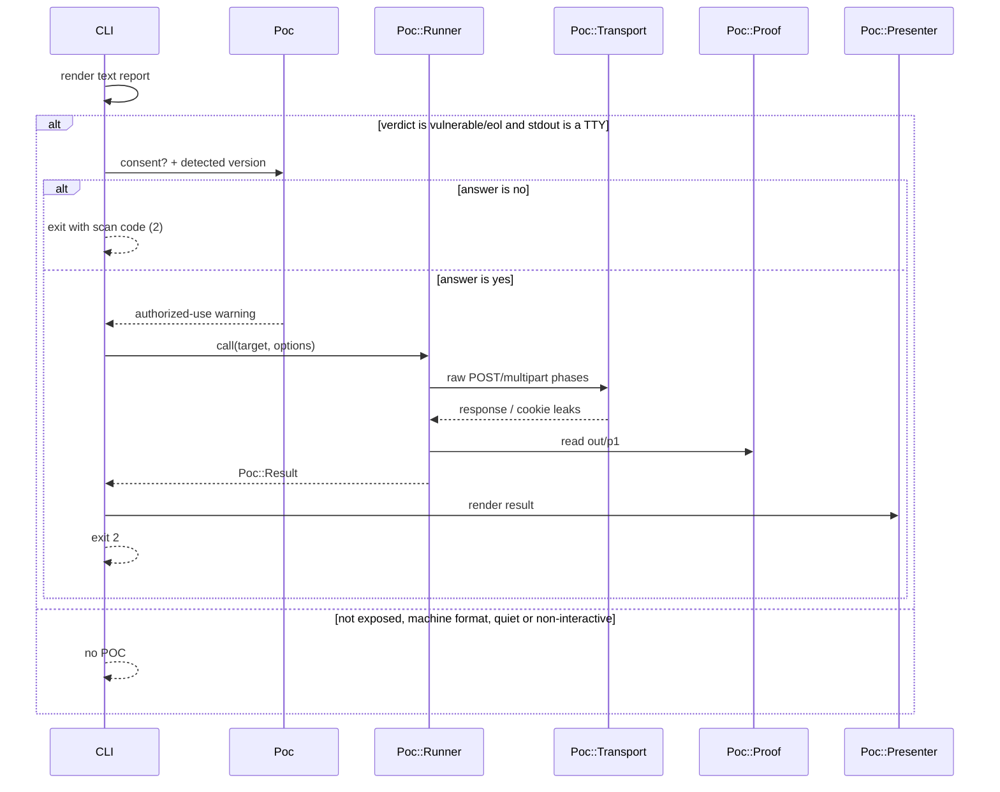
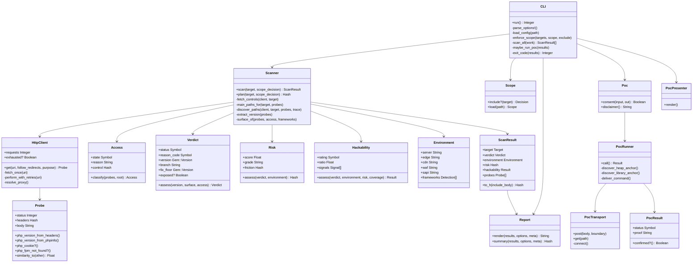
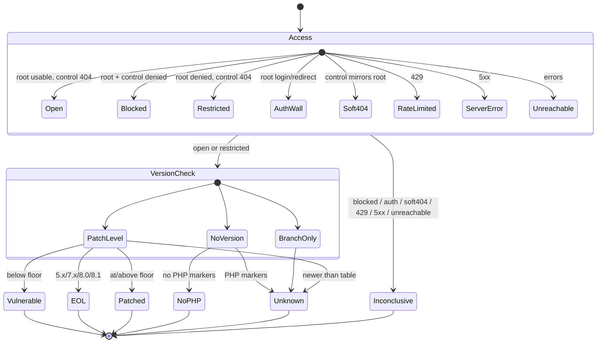

# PHP2ShellPOC2026 — architecture

Four views of the 3.0 system. All diagrams are Mermaid and render on GitHub.

- [Scan sequence](#scan-sequence) — what happens for one target
- [Authorized POC sequence](#authorized-poc-sequence) — the post-scan y/N path
- [Class map](#class-map) — what exists and who owns policy
- [Verdict state machine](#verdict-state-machine) — how evidence becomes a status

---

## Scan sequence

The key ordering: **scope before socket**, **control before trusting status
codes**, **access before version**, **exposure before friction**, **kill chain
only after confirmed exposure**.

---

## Authorized POC sequence

The POC is not a scanner probe. It is reached only from the interactive text
path, never from JSON/SARIF/CSV/NDJSON, `--quiet` or non-interactive output.

---

## Class map

Policy lives in the decision modules, not in `Scanner`:

- `Access` decides what the edge did.
- `Verdict` decides what the version means.
- `Risk` decides exposure severity and friction separately.
- `Hackability` weighs evidence and returns `nil` when there is none.
- `Report` never sees an HTTP response, only a `ScanResult`.
- `Poc::Runner` owns the authorized attack phases; `Poc::Transport` is the
  only POC socket; `Poc::Presenter` only prints the result. The POC is never
  called from a machine-readable report.

---

## Verdict state machine

`Inconclusive` is a terminal state, not a failure to be retried silently. It
means the scan could not produce usable application evidence; the next step is
host-side verification or an approved vantage point, not a claim of safety.
