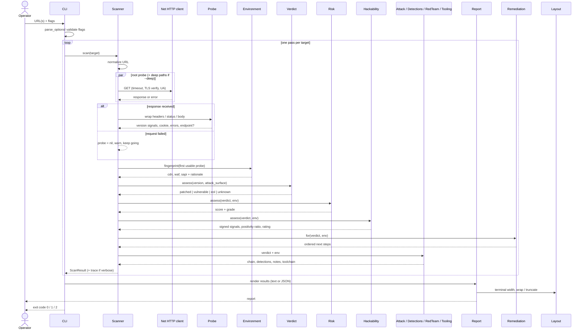
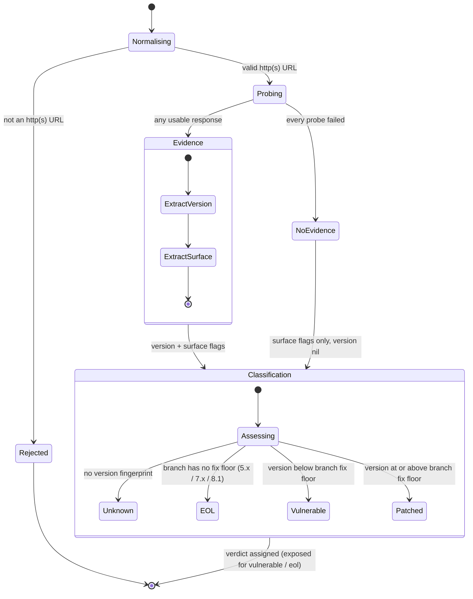
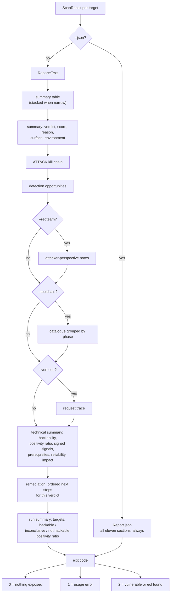

# PHP2ShellPOC2026 — UML diagrams

Four views of the system, each answering a different question. All diagrams
are Mermaid and render natively on GitHub.

- [Class diagram](#class-diagram) — what exists, and how it relates
- [Scan sequence](#scan-sequence) — what happens, in order, for one target
- [Verdict state machine](#verdict-state-machine) — how a target reaches a verdict
- [Rendering flow](#rendering-flow) — how a ScanResult becomes output

---

## Class diagram

Everything in the system, grouped by role. The left column is the evidence
objects the scan produces evidence *with*; the centre is the scanner that
orchestrates them; the right column is enrichment — four independent modules
that each read the verdict and environment and contribute a section of the
report. Structs are marked `<<Struct>>`; they are plain data records with no
behaviour of their own beyond `to_h`.

Notable design points:

- **`Verdict` owns classification policy** (`FIXED_RELEASES`, `assess`), not
  the scanner — the scanner asks for a verdict, it does not decide what one
  means. Everything downstream keys off `exposed?`.
- **`ScanResult` is the handoff type** between scanning and presentation.
  `Report` never sees a `Probe` or an HTTP response, only a `ScanResult`.
- **Enrichment modules are pure**: verdict and environment in, records out.
  None of them performs I/O, which is why they are trivially testable and
  why adding a fifth one cannot break scanning.
- **`Hackability` weighs, it does not decide**: it turns observed signals
  into a signed ratio and a rating, but its clamps (no PHP observed ⇒ never
  above NOT HACKABLE, unconfirmed fingerprint ⇒ never above LIKELY) mean the
  number can only ever be as confident as the evidence underneath it. Risk
  answers "how bad if true"; Hackability answers "how sure are we, now".

```mermaid
classDiagram
    class Verdict {
        <<class>>
        +Symbol status
        +Gem::Version version
        +String version_source
        +String reason
        +Hash attack_surface
        +Hash FIXED_RELEASES
        +assess(version, attack_surface, version_source) Verdict
        +exposed? Boolean
        +to_h Hash
    }

    class Probe {
        <<class>>
        +URI uri
        +Hash headers
        +Integer status
        +String body
        +php_powered_by String
        +session_cookie? Boolean
        +php_error_page? Boolean
        +version_from_phpinfo String
        +php_endpoint? Boolean
    }

    class Environment {
        <<class>>
        +String server
        +String cdn
        +String waf
        +String sapi
        +String sapi_rationale
        +cdn? Boolean
        +to_h Hash
        -detect_cdn headers
        -detect_waf headers
        -detect_sapi headers
    }

    class Scanner {
        <<class>>
        +Integer timeout
        +Boolean verify_tls
        +Boolean deep
        +Boolean verbose
        +scan(target) ScanResult
        -normalize(target) URI
        -fetch(uri) Probe
        -extract_version(probes) Version
        -surface_of(probes) Hash
        -trace(line)
    }

    class ScanResult {
        <<Struct>>
        +String target
        +Verdict verdict
        +Environment environment
        +Hash risk
        +Technique[] attack_chain
        +Layer[] detections
        +String[] red_team
        +Entry[] tooling
        +Hash fingerprint
        +Result hackability
        +String[] remediation
        +String[] trace
        +exposed? Boolean
        +to_h Hash
    }

    class Risk {
        <<module>>
        +Hash BASE
        +assess(verdict, environment) Hash
        +grade(score) String
        -apply_sapi(base, verdict, environment) Float
    }

    class Hackability {
        <<module>>
        +Hash RATINGS
        +assess(verdict, environment) Result
        +rate(ratio, verdict, surface) Symbol
        +build_signals(verdict, environment, surface) Signal[]
        +prerequisites(verdict, environment, surface) String[]
        +reliability(verdict, environment) String
        +impact(verdict) String
    }

    class Signal {
        <<Struct>>
        +Symbol direction
        +Integer weight
        +String label
    }

    class Result {
        <<Struct>>
        +Symbol rating
        +String label
        +Float ratio
        +Integer positive
        +Integer negative
        +String[] prerequisites
        +String reliability
        +String impact
        +Signal[] signals
        +hackable? Boolean
        +to_h Hash
    }

    class Remediation {
        <<module>>
        +for(verdict, environment) String[]
        +vulnerable(verdict, environment) String[]
        +eol(verdict, environment) String[]
        +patched(verdict) String[]
        +unconfirmed String[]
        +edge_steps(environment) String[]
    }

    class Layout {
        <<module>>
        +width Integer
        +wrap(text, limit) String[]
        +wrap_hanging(prefix, text) String[]
        +truncate(text, limit) String
        +table(headers, rows) String[]
        -terminal_width Integer
        -greedy(text, limit) String[]
        -chunk(line, limit) String[]
        -shrink(naturals, usable) Integer[]
        -stacked(headers, rows) String[]
    }

    class Attack {
        <<module>>
        +techniques_for(verdict) Technique[]
    }

    class Technique {
        <<Struct>>
        +String id
        +String name
        +String tactic
        +String applies
        +String note
    }

    class Detections {
        <<module>>
        +for(verdict, environment) Layer[]
        +exposure_layers Layer[]
        +origin_layer(environment) Layer
        +config_layer Layer
    }

    class Layer {
        <<Struct>>
        +String layer
        +String control
        +String detail
    }

    class RedTeam {
        <<module>>
        +notes(verdict, environment) String[]
    }

    class Tooling {
        <<module>>
        +catalogue(verdict, environment) Entry[]
        +core Entry[]
        +origin_discovery(environment) Entry
        -entry(phase, tool, purpose, relevance, techniques) Entry
    }

    class Entry {
        <<Struct>>
        +String phase
        +String tool
        +String purpose
        +String relevance
        +String[] techniques
    }

    class Report {
        <<module>>
        +json(results) String
    }

    class Text {
        <<class>>
        +Boolean redteam
        +Boolean toolchain
        +Boolean verbose
        +render()
        -summary(target, result)
        -attack_chain(result)
        -detections(result)
        -red_team(result)
        -toolchain(result)
        -trace(result)
    }

    class CLI {
        <<class>>
        +String[] argv
        +Integer run()
        -parse_options!()
        -scan_all(scanner) Hash
    }

    Scanner --> Probe : constructs per request
    Scanner --> Environment : builds from first probe
    Scanner --> Verdict : assess
    Scanner --> ScanResult : returns
    Risk --> Verdict : reads status
    Risk --> Environment : reads sapi / cdn
    Hackability --> Verdict : reads
    Hackability --> Environment : reads
    Hackability --> Signal : produces
    Hackability --> Result : builds
    ScanResult *-- Result
    Remediation --> Verdict : reads
    Remediation --> Environment : reads
    Text --> Layout : measures width
    Attack --> Technique : produces
    Detections --> Layer : produces
    Tooling --> Entry : produces
    Attack --> Verdict : reads
    Detections --> Verdict : reads
    RedTeam --> Verdict : reads
    Tooling --> Verdict : reads
    ScanResult *-- Verdict
    ScanResult *-- Environment
    CLI --> Scanner : one scan per target
    CLI --> Report : renders through
    Report --> Text
    Text --> ScanResult : reads
```

## Scan sequence

What actually happens for a single target, including the failure path: a
probe that cannot be completed comes back `nil`, the usable set shrinks, and
classification proceeds on whatever evidence survived — which is exactly how
a reachable host with one dead path still gets a real verdict.

## Verdict state machine

How a target moves from raw input to one of the four verdicts. The branch
order is the policy: no version short-circuits to `unknown`, a branch missing
from `FIXED_RELEASES` is `eol` before any version comparison happens, and
only branches that *do* have a published fix ever compare against their floor.

## Rendering flow

A `ScanResult` is produced once and rendered from; display flags affect only
the text renderer. JSON always carries all eleven sections — presentation
decisions never remove data from the machine-readable format — which is why
the two branches below differ in what they pass along but not in what was
collected.

